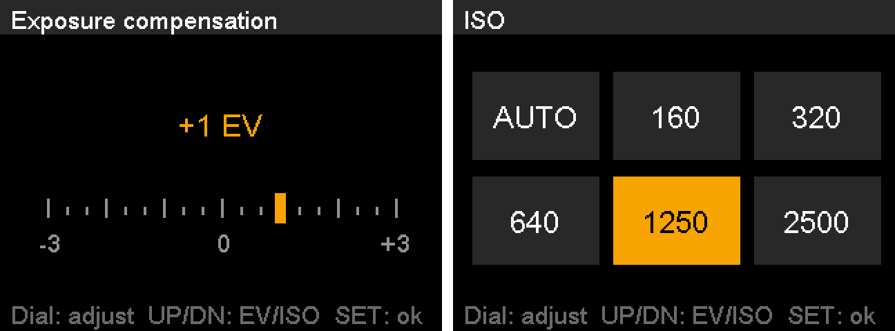

# leica-m8-firmware

Tools for patching the firmware of the **Leica M8** so it:

1. **Keeps "JPG fine+RAW" selected.** This hidden service-mode setting saves the sensor's full 14-bit
   data. Stock firmware hides it and resets it at every power-on; the patch makes it a normal SET menu
   choice that stays selected.
2. **Writes a 14-bit DNG in the camera.** In JPG fine+RAW mode, the camera saves a JPG plus a 14-bit
   DNG that Lightroom opens directly, with exposure time, ISO, capture date, **the camera's own
   white balance** (Lightroom's "As Shot" matches the JPG) and the Leica MakerNote. The camera's own
   DNG mode is 8-bit (companded); this keeps the full sensor data and needs no conversion step.

Optional add-ons:

- **INFO shows Camera stats** (`--info`, experimental): shutter count, battery, temperature and lens code.
- **Exposure compensation on the rear dial** (`--dial-ev`): turn the dial in shooting mode instead
  of going through the SET menu.

> **Status: tested on the author's camera; the DNG writer also on a second M8.** Every part runs on
> the author's M8 with firmware 2.014, and the DNG writer with and without `--dial-ev` was tested
> independently on another M8. It is experimental, not affiliated with or endorsed by Leica, and
> flashing modified firmware is at your own risk. Read [Safety and recovery](#safety-and-recovery)
> before flashing anything.

**No Leica firmware is included in this repository**, and none should ever be added: the firmware is
Leica's copyright. You supply your own copy of the stock update file; every script checks its SHA-256
and refuses anything else.

## Contents

- [Why 14-bit?](#why-14-bit)
- [What you get](#what-you-get)
- [Requirements](#requirements)
- [Build your firmware file](#build-your-firmware-file)
- [Flash it](#flash-it)
- [Safety and recovery](#safety-and-recovery)
- [Known limitations](#known-limitations)
- [Work in progress: picture profiles](#work-in-progress-picture-profiles)
- [Work in progress: RAW-only shooting](#work-in-progress-raw-only-shooting)
- [How it works](#how-it-works)
- [For developers](#for-developers)
- [Testing without a camera](#testing-without-a-camera)
- [Repository layout](#repository-layout)
- [Credits](#credits)
- [License](#license)

## Why 14-bit?

The M8's own DNG mode doesn't store what the sensor recorded. Analysis of its files (details in
[`docs/FINDINGS.md`](docs/FINDINGS.md), "Camera's own 8-bit DNG") shows that before saving, the camera:

- **subtracts the black level and clips everything below it to zero.** In a test frame, about 6% of
  all pixels were exactly 0. The faint noise and detail just above and below black are thrown away.
- **compresses the remaining range to 8 bits (256 levels)** with a square-root curve.

Apart from that it's still raw data: no noise reduction, sharpening or demosaicing.

The 14-bit file keeps every sensor value: 16,384 levels, with black recorded as metadata instead of
cut off. In practice that means:

- **Better shadow recovery.** When you lift dark areas, the 14-bit file has real tonal data and
  natural noise there, instead of clipped, blotchy blacks.
- **Smoother gradients under heavy edits.** The 8-bit file's steps are about as large as the sensor
  noise at base ISO, which hides them in normal use. Strong curves or large exposure pushes can turn
  them into banding in skies and smooth surfaces; the 14-bit file has 64× finer steps.
- **More room for later processing.** Lightroom's denoise and black-level adjustments, or tools like
  m8raw2dng2's dark-frame corrections, work from the untouched data.

At normal exposure with moderate edits, the two look very similar: the difference shows when you
push a file. The cost is size. A 14-bit raw is about 21 MB, twice the camera's DNG, so cards fill
faster and each shot takes longer to save.

## What you get

After flashing, choose SET → Compression → **JPG fine+RAW** once; it stays selected. Each shot
then produces:

- `L10xxxxx.JPG`: the camera's normal JPG, used by in-camera review.
- `L10xxxxx.RAW`: 21,049,052 bytes. Its contents are a complete 14-bit DNG (uncompressed CFA, M8
  colour matrices, white level 16383, black level matched to the ISO) with, from the shot:
  - exposure time, exposure program, ISO, shutter value, exposure bias, max aperture, focal length
    and date;
  - **the white balance the camera used** (DNG AsShotNeutral). Lightroom's "As Shot" matches the
    JPG, with Auto as well as with a preset such as Tungsten. If the camera ever has no value ready,
    the file falls back to a daylight balance, so it always opens;
  - **the Leica MakerNote**, the same 18 entries as in the JPG: body serial, lens code, the light
    meter's readings, and so on. The lens code is only set when the body identified the lens (a
    6-bit coded lens with lens detection on).

Lightroom opens the `.RAW` file as is; for other software, rename the extension to `.DNG`. The
image data is the camera's own 14-bit RAW, untouched, so [m8raw2dng2](https://github.com/botrx555/m8raw2dng2)
still converts these files if you want its extras (dark-frame subtraction, defect-column repair,
lens names for uncoded lenses).

The other Compression modes (JPG fine, JPG basic, DNG, DNG+JPG) are unchanged stock code. Switching
to one of them turns the new code off completely.

### Add-on: INFO Camera stats (`--info`, experimental)

On a stock M8 the INFO button does nothing in shooting mode; with `--info` it shows:

<p align="center"></p>
<p align="center"><sub>The screen as drawn by the patch code, rendered in the emulator with the
camera's own drawing routines and fonts (<code>tools/m8_inforender.py</code>). Values are example
values, shown 2× size.</sub></p>

| Shots taken | Battery | Temperature | Lens code | Firmware |
|---|---|---|---|---|
| the body's shutter counter | Empty … Full | the body's reading, shown as °C | the code the body reads from the lens mount | 2.014 + INFO |

INFO or SET closes it; every other key is ignored while it is open. The values are the ones Leica's
hidden service page "Body Debug Data" shows; the screen asks the body controller for them the same
way that page does (a read-only request). Service mode is unchanged: after the service button
sequence, INFO still opens the service menu. The screen is in English only. Tested on the author's
camera.

### Add-on: Exposure compensation on the rear dial (`--dial-ev`)

On a stock M8, exposure compensation is only in the SET menu. With `--dial-ev`, turning the rear
dial in shooting mode changes it by ⅓ EV per click (−3 to +3 EV) and shows the value on the screen:

<p align="center"></p>
<p align="center"><sub>Rendered in the emulator with the camera's own drawing routines and fonts
(<code>tools/m8_evtest.py</code>), 2× size.</sub></p>

- The value changes with every click, straight away; it shows in amber when it isn't 0.
- The screen closes 2 seconds after the last click, or at once with SET, INFO, any other button or
  the shutter. The value stays set, also after power-off, exactly like a SET-menu change: it is the
  same setting, changed by Leica's own (unused) dial routine found in the firmware, and the shot's
  EXIF shows it.
- Works in every shooting mode where the menu setting does. Service mode and Simple mode are
  unchanged (the dial does nothing there, as in stock).

It combines with `--info`. Tested on the author's camera and, with the DNG writer, on a second M8.

## Requirements

- A Leica M8 running firmware **2.014**, the only version these patches are made and tested for.
- Leica's stock 2.014 update file, unmodified: `m8-2_014.upd`, SHA-256
  `99f5254847a92c68086f37b1a4140c359379801b479df12052136abb73f09ed0`. The same file is used to
  return to stock.
  - **Where to get it:** Leica's own download links for 2.014 are gone. The author's copy came from
    the French driver archive TousLesDrivers:
    [Leica M8/M8.2 firmware 2.014](https://www.touslesdrivers.com/index.php?v_page=23&v_code=38007&v_langue=en)
    (`m8-2_014.zip`, 2.1 MB; unzip it to get `m8-2_014.upd`). Softpedia also lists it. Any copy
    works as long as its SHA-256 matches the one above: `m8patch.py` checks this and refuses
    anything else, so a damaged or altered file can't get through.
  - **Coming from 2.024:** owners report downgrading 2.024 → 2.014 with this file (the updater
    accepts older versions; see [FINDINGS](docs/FINDINGS.md#updater-behaviour-pxa)). The author's
    camera was already on 2.014, so the downgrade itself hasn't been tested here. What you give up:
    2.024 adds lens names for newer lenses and a newer build of the image-processor program; the
    JPG tone curves and everything these patches use are the same
    ([details](docs/FINDINGS.md#what-2024-changed-static-2026-10-27)).
- Python 3 (any recent version; the one built into macOS works). Nothing else to install.

## Build your firmware file

Download or clone this repository, then run, with the path to your stock file:

```sh
python3 m8patch.py ~/Downloads/m8-2_014.upd                      # the build
python3 m8patch.py ~/Downloads/m8-2_014.upd --info --dial-ev     # with both add-ons
```

`--info` and `--dial-ev` can be used alone or together. The script:

- only reads your stock file and never changes it;
- refuses anything that isn't Leica's unmodified 2.014 file;
- writes the result to `build/m8-2_014-patched.upd` (with add-ons: `…-patched-info.upd`,
  `…-patched-dial.upd`, `…-patched-info-dial.upd`). It never overwrites an existing file;
  `--out-dir DIR` writes somewhere else;
- writes it only if it is byte-identical to one of the builds below, and prints its SHA-256, whether
  that exact file was tested on a camera, and the next steps.

### Builds

Each build is made of pieces: the RAW patch with the DNG writer (always), Camera stats and the dial.
**Every piece has been tested on a camera.** The pieces live in separate parts of the firmware and
don't touch each other, so a build contains each piece's code byte for byte as it was tested;
`tools/m8_combotest.py` checks this for all four builds, and the emulator tests run each of them.
Builds marked *exact* were also flashed as that exact file.

| Build (2.014) | SHA-256 | On a camera |
|---|---|---|
| the build | `9b9a489a0decff5bc1a52ba8ff2b4574a608ae7a8fa1bc41fc6bfa9a49c02c04` | pieces |
| + `--info` | `624448c6190de500028e4c583993cf9047c791504e5f9bc4c45a31b79af42af8` | pieces |
| + `--dial-ev` | `bd914f4db75ab311f852acae81088e8250fe6ed90a093c89567d96e20708122a` | pieces |
| + `--info --dial-ev` | `4382b20c1e36e8c1b0fba0a4871e4391154b789f584f23785924690adc86bbe7` | exact |

*Pieces*: each piece was flashed and tested on a camera inside an earlier build: the DNG writer
with white balance in `4359b04b…` (2026-11-05/06), Camera stats in `32e6854e…` (2026-10-23), the
dial in `1254b743…` (2026-11-02), see [CHANGELOG](CHANGELOG.md). If you flash one of these builds,
please report how it went (add-ons, SHA-256) in an issue.

Earlier versions offered more combinations (Option 1 without the DNG writer, the DNG writer without
white balance, the picture-profile picker). Their hashes stay in the [CHANGELOG](CHANGELOG.md), so a
file built with an earlier version can still be checked.

## Flash it

1. **Fully charged battery.**
2. Keep a **second card holding only the stock `m8-2_014.upd`**, ready to roll back.
3. Format a card in the camera and copy the built file from `build/` onto it. **On the card, rename
   it to `M8-2_014.UPD`**: the updater only looks for `M8.UPD` or `M8-x_yyy.UPD`. Rename the copy on the card, not your stock file.
4. Run the camera's normal firmware update, the same as for Leica's own file. The progress bar
   usually pauses around 60% before completing. **Don't touch the battery or card while it runs.**
5. After the restart: SET → Compression → **JPG fine+RAW**. Take a test shot and open its `.RAW` in
   Lightroom: White Balance "As Shot" should look like the JPG. With `--info`, press INFO in
   shooting mode: Camera stats appears, INFO or SET closes it. With `--dial-ev`, turn the rear dial
   in shooting mode.

## Safety and recovery

**What the patches change, and what they don't.** The RAW patch changes three instructions: one in
the settings loader, which runs at every start-up (it keeps JPG fine+RAW instead of resetting it),
and two in the SET-menu loader (they list it in Compression). The DNG writer adds its code, reached
from the RAW writer's last block, plus one changed branch in the file-save routine: in JPG fine+RAW
mode the RAW asks the image processor for the white balance first, as a DNG does in stock DNG+JPG
mode. `--info` adds the INFO screen (reached through one changed branch), and `--dial-ev` adds the
dial code (two changed branches in the key handler plus one entry of the screen's event table, for
its 2-second close).
Everything else stays byte-identical: the bootloader (RedBoot, not in the update file at all), the
SD-card updater, the rest of the startup code and of settings load/save, and every other part of
the update file (DSP, FPGA, body controller, fonts, lens table). The patch scripts check this
automatically on every build (details: [docs/FINDINGS.md](docs/FINDINGS.md)). The new DNG code runs
only while a JPG fine+RAW shot is being saved, never at startup or during an update. It writes only
into the unused last sensor row of the image buffer, and it range-checks every write. The `--info`
code runs only when INFO is pressed in shooting mode; it opens the screen the way the camera's own
service menu does, draws with the camera's own drawing routines, and changes no settings. The `--dial-ev` code runs only when the dial is turned in shooting mode; it changes
exposure compensation with the camera's own routine for it, which updates the setting the same way
the SET menu does (and like the menu, the camera saves it at power-off), and shows it with the same
screen mechanism as `--info`.

**Rolling back.** The updater accepts the same or an older version, so flashing the stock
`m8-2_014.upd` from the card returns the camera to stock. This relies on the patched firmware
starting up: the SD-card updater is part of the same program, so a build that failed to start
would also block recovery from the card (it would then need Leica service). That is why every
build is emulator-tested before it is published and the start-up changes are kept to the one
instruction above. The author has done patched → stock → patched on hardware. Before sending the
camera to Leica for service, reflash stock.

**If something looks wrong while shooting** (freeze, error, odd behaviour):

1. **Pull the battery first.** Not the power switch, and don't remove the card. Power-state changes
   and card insert/remove make the camera save its settings; a battery pull saves nothing.
2. Power on, set Compression to **JPG fine** (the new code never runs then), and reflash stock.

## Known limitations

- **Tested on two cameras so far** (the author's, and the DNG writer with and without the dial on a
  second M8). Single shots, long exposures, power cycles, and continuous shooting until the buffer
  fills (without the DNG writer) are tested; the DNG writer hasn't had the full burst test yet.
- **The files are named `.RAW`, not `.DNG`.** A build that names them `.DNG` exists (stage 5,
  for developers), but on the camera, review of a JPG + `.DNG` pair then shows only the DNG's file
  name and can't reach the JPG, because these DNGs have no embedded preview. Keeping `.RAW` keeps
  in-camera review working normally.
- **Black level** follows the ISO (92 at ISO 160, doubling per step to 1472 at ISO 2500, the rule
  from Arvid Kuehl's m8raw2dng, confirmed on the author's camera). One value for all four colour
  channels; whether green needs a slightly higher value is still open.
- **Not included yet:** lens name and an embedded preview.
- **`.BIA` dark frames** (written for long exposures) also get the TIFF header bytes, but no DNG tags.
  Converters that skip the header, such as m8raw2dng2, aren't affected.
- **Firmware 2.014 only.** Other versions haven't been tested, and the scripts refuse them.
- **`--info`:** the screen is English only, and the temperature is the body's own reading, shown as
  °C. If the camera is switched off while Camera stats is open, the service page "Body Debug Data"
  shows Camera stats instead until the next restart (no effect outside service mode).
- **`--dial-ev`:** the value shows on the rear screen only, not in the viewfinder (Leica's own,
  unfinished version of this feature would have used the viewfinder display, but the body controller
  never enables it). A bumped dial changes the compensation; the screen lights up when that happens.
- **Three of the four builds** are made of camera-tested pieces but haven't been flashed as those
  exact files yet; `--info --dial-ev` has (see [Builds](#builds)).

## Work in progress: picture profiles

Up to v0.7.0 an add-on (`--profiles`) let the camera load other JPG tone curves from the SD card,
for example film looks from Nikon Picture Control files: INFO → UP opened a list, SET loaded one
until power-off. It worked on the camera, but how it works isn't good enough yet, so it is not
offered for now and will come back reworked.

The research and tools stay in the repository: `tools/m8_profile.py` (turns Nikon `.ncp` files or
curve points into card files), `tools/m8_curvesim.py` (previews a curve on your own RAW), and the
notes in [FINDINGS "JPG tone curves"](docs/FINDINGS.md#jpg-tone-curves-and-picture-profiles-from-the-card-static-2026-10-23-research-only).
The `.LUT` files these tools make contain Leica data taken from your stock file, so keep them for
yourself, like the firmware.

## Work in progress: RAW-only shooting

Someone asked for saving only the RAW file (no JPG), to write faster. For that the camera's PLAY
button would have to show our DNGs. The research showed PLAY reads a DNG's raw data itself, and a
test build in the layout PLAY expects got that far: PLAY opened the files, but drew horizontal lines
and a washed-out purple image instead of the picture. The camera's display code seems to expect its
own raw format (smaller frame, 8-bit, black level removed), which our untouched 14-bit data isn't.
So RAW-only isn't offered; the builds keep writing the JPG next to the DNG. The notes are in
[FINDINGS "How PLAY reads a DNG"](docs/FINDINGS.md#how-play-reads-a-dng-static-2026-11-06-research-for-raw-only).

## How it works

The M8's update file is an uncompressed container ("PWAD") with no overall checksum. Its `PXA` part is
the main ARM program (Intel XScale, ARMv5TE, loaded at `0x20000`). Everything was found by static
analysis with Capstone and Ghidra, then checked in an emulator and on the camera.

- **Persistent RAW:** two branches that reset Compression 5 (JPG fine+RAW) to 1 are removed, at boot
  and when the SET menu opens. One constant makes the menu list six entries instead of five.
- **In-camera DNG:** the RAW file is already uncompressed 14-bit data with a 108-byte header,
  2,646 rows × 3,976 samples, and one unused trailing row. TIFF lets the tag directory sit anywhere,
  so the build:
  1. rewrites the header code so the first 8 bytes become a TIFF header pointing at the trailing row
     (same number of instructions, in place);
  2. adds a `bl` in the RAW writer's last-block branch to a small routine. The routine sits where the
     unused `writejpgipp` debug command used to be; its tables sit in the unused `ldimg` command.
  3. The routine copies a 1,192-byte DNG tag block (with the Leica MakerNote laid out as the JPG's)
     into the trailing row and fills the per-shot values from the shot's metadata, which the camera
     already holds for the JPG. The white balance is copied only when it has the form the image
     processor gives it.
  4. One more branch in the file-save routine makes the RAW ask the image processor for the white
     balance (and the review image) before its data, as a DNG does in stock DNG+JPG mode.

  The pixels are never touched or copied, and the file size and write path stay as in stock RAW
  mode; the white-balance request adds a short step before the RAW is written.
- **INFO Camera stats (`--info`):** one branch in the GUI's key handler sends INFO (outside service
  mode, where stock ignores it) to new code in the space of two unused Blackfin-test debug commands.
  It opens the service menu's Body Debug Data dialog the way the service menu does, with its own
  drawing and key methods while open, and restores the dialog's methods on close.
- **Dial EV (`--dial-ev`):** the rear dial sends two keys (`c`/`w`) that stock ignores in shooting mode.
  The firmware already contains Leica's step routine for them (part of an unused "EV fast access"
  window); two branches in the key handler send the dial keys to new code (in the space of the
  unused `setting` debug command), which calls that routine and shows the value on the same borrowed
  dialog as INFO. The dialog's own timer, re-aimed through one entry of the screen's event table,
  closes it after 2 seconds.

Every address, offset and decision, with the evidence for it, is in
[`docs/FINDINGS.md`](docs/FINDINGS.md). The design, staging and risk assessment are in
[`docs/DNG_PLAN.md`](docs/DNG_PLAN.md).

## For developers

`m8patch.py` is a thin front end. The builds come from the tools in `tools/`:

- `tools/m8_rawpatch.py` builds the RAW patch alone (Option 1 of earlier versions). `--no-menu`
  keeps the hidden button sequence for selecting RAW but still makes the choice stick.
- `tools/m8_dngpatch.py` builds from pieces: the offered builds as `dng --meta [--info] [--dial-ev]`,
  and every earlier combination (`raw-menu`, `dng` without `--meta`, `--profiles`). It prints every
  changed instruction and checks that nothing outside the pieces' declared regions changed. Each
  piece's camera test is recorded in `TESTED_PIECES`.
- Builds used to be numbered "stages". The diagnostic builds keep their numbers (`--stage N`): 1 =
  header canary, 2 = new code present but not hooked in, 3 = metadata dump, 5 = `.DNG` names, plus
  6, 7, 11, 12 (early INFO and tone-curve experiments). The old numbers of the regular builds (4, 8,
  10, 13–20) still work as aliases, so the notes in `docs/FINDINGS.md` resolve.

```sh
python3 -m venv work/venv && work/venv/bin/pip install -r requirements.txt   # Capstone, Unicorn, …
work/venv/bin/python tools/m8_dngpatch.py firmware/stock/m8-2_014.upd work/m8.upd dng --meta --info --dial-ev
```

## Testing without a camera

Unicorn-based emulator suites run the real firmware code from the stock file:

```sh
work/venv/bin/python tools/m8_emutest.py              # settings loader + SET menu, stock vs RAW patch
work/venv/bin/python tools/m8_savetest.py --build dng --meta   # a simulated shot through the real save path
work/venv/bin/python tools/m8_savetest.py                       # the same for every build
```

How long they take (Apple M4 Max; expect longer on slower machines). Each prints `N passed, 0 failed`
at the end and prints little before that, so a long silence is normal.

| Command | What it covers | Time |
|---|---|---|
| `m8_emutest.py` | the RAW patch: settings loader and SET menu | ~1 s |
| `m8_savetest.py --build dng --meta` | one build through the save path | ~2.5 min |
| `m8_savetest.py` | the 4 builds + the diagnostic builds, all variants | ~10 min |
| `m8_infotest.py` | INFO builds: key handling, every key in every GUI state | ~10 s |
| `m8_inforender.py` | INFO screens: rendered with the camera's drawing code (PNG) | ~2 s |
| `m8_evtest.py` | `--dial-ev` builds: key handling in every GUI state, close timer, Leica's EV step, screen | ~20 s |
| `m8_combotest.py` | the 4 `m8patch.py` builds: hashes, each piece byte-identical to its camera-tested build | ~4 s |
| `m8_metacheck.py` | camera files: DNG white balance and MakerNote vs the JPG (plain Python) | ~1 s |

`m8_savetest.py` runs the real store routine, DMA handler, ring buffer and RAW writer. It models the
DMA controller and the card-writer task. For each build it compares the file that reaches the "card"
byte for byte with an independently computed expectation, logs every write the new code makes, and
checks that boot and update code are untouched. The stock build reproduces real camera files exactly.

The save-path test needs camera files, which aren't in the repository: `sampleraws/L1031902.RAW` +
`L1031902.JPG` (a JPG fine+RAW pair) and `sampleraws/L1031901.RAW`. Use your own files under those
names. `m8_emutest.py` needs the RAW-patch build at `firmware/patched/m8-2_014.upd`.

## Repository layout

| Path | Contents |
|---|---|
| `m8patch.py` | Build your firmware file, with or without the add-ons, from your stock file (start here) |
| `CHANGELOG.md` | Versions of this project, with the hash of every build ever offered |
| `tools/m8_rawpatch.py` | Persistent-RAW patch (2.014) |
| `tools/m8_dngpatch.py` | Builds from pieces (same flags as `m8patch.py`; diagnostic builds via `--stage N`), with region and hash checks |
| `tools/asm/` | Assembly source of the new code (DNG: `m8_header.s`, `m8_dngmeta.s`, earlier `m8_dnghook.s`; INFO and dial: `m8_info*.s`) |
| `tools/m8_profile.py`, `tools/ncp.py`, `tools/m8_curvesim.py` | Picture profiles (work in progress): .LUT builder, Nikon .NCP reader, curve preview |
| `tools/m8_asm.py` | Assembles one source with clang and checks it against the frozen bytes |
| `tools/m8_wrapdng.py` | Desktop RAW → DNG wrapper; the reference for the in-camera file and its tag template |
| `tools/m8_metacheck.py` | Checks camera files: DNG white balance and MakerNote against the JPG |
| `tools/m8_emutest.py`, `tools/m8_savetest.py`, `tools/m8_infotest.py`, `tools/m8_inforender.py`, `tools/m8_evtest.py`, `tools/m8_combotest.py` | Emulator and build tests (durations under [Testing](#testing-without-a-camera)) |
| `tools/m8_font.py` | Decodes and renders the camera's GUI fonts |
| `tools/m8_reclaim.py` | Ranks unused debug commands as space for new code |
| `tools/armtools.py`, `tools/split_upd.py`, `tools/ghidra/` | Analysis helpers |
| `docs/FINDINGS.md` | Reverse-engineering notes: addresses, formats, hardware test log |
| `docs/DNG_PLAN.md` | Design and staged plan for the in-camera DNG |
| `firmware/`, `build/`, `sampleraws/`, `work/` | Local only (git-ignored): firmware files, build output, camera samples, scratch |

## Credits

- **Arvid Kuehl** — the original m8raw2dng (m8raw2dng.de), who discovered how to unlock the M8's
  uncompressed RAW mode and turn its dumps into DNGs.
- **romanvail** — first surfaced the uncompressed-RAW mode on the Leica User Forum.
- **botrx555** — [m8raw2dng2](https://github.com/botrx555/m8raw2dng2), whose documentation of the RAW
  format and converter settings this work builds on.
- **Alex Hude** — "How to Hack an Expensive Camera…", the write-up on Leica's update-file format.

Leica and M8 are trademarks of Leica Camera AG. This project isn't affiliated with Leica Camera AG.

## License

The scripts, assembly sources and documentation in this repository are released under the
[MIT License](LICENSE). The license covers only this project's own work, not Leica's firmware, which
is not included and must not be added.
